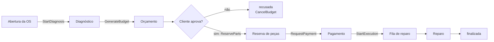
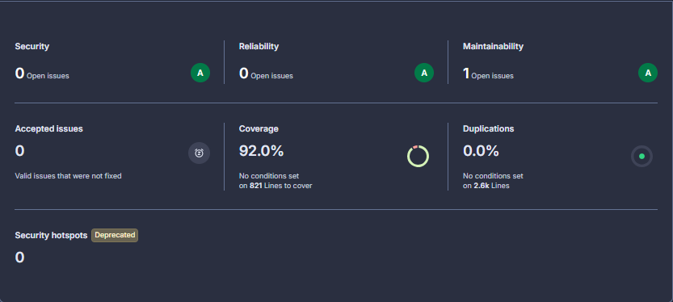

# OS Service — AutoShop (`app-autoshop`)

Microsserviço de **ordens de serviço (OS)** da oficina e **orquestrador da
Saga**: cadastro de clientes, veículos e serviços, abertura e acompanhamento
das OS, e condução do fluxo da OS entre os demais serviços.

Faz parte da arquitetura de microsserviços do AutoShop:

| Serviço | Repositório | Banco |
|---|---|---|
| OS Service (este) | `app-autoshop` | PostgreSQL |
| Execution Service | [`execution-autoshop`](https://github.com/Jackeline2020/execution-autoshop) | DynamoDB |
| Billing Service | [`billing-autoshop`](https://github.com/Jackeline2020/billing-autoshop) | PostgreSQL |
| Autenticação por CPF | [`lambda-auth-autoshop`](https://github.com/Jackeline2020/lambda-auth-autoshop) | — |
| Mock do Mercado Pago | [`payment-mock-autoshop`](https://github.com/Jackeline2020/payment-mock-autoshop) | — |

A visão geral, o fluxo da Saga e as decisões de arquitetura ficam em
[`docs/`](docs): [arquitetura](docs/architecture.md),
[fluxo da OS](docs/saga-flow.md), [RFCs](docs/rfc) e [ADRs](docs/adr).

## Responsabilidades

- Cadastro de clientes, veículos e serviços
- Abertura da OS (as peças são consultadas no catálogo do Execution Service)
- Orquestração da Saga: decide cada passo, envia os comandos ao Execution e
  ao Billing, aplica os eventos de resposta e dispara as compensações
- Acompanhamento da OS pelo cliente e aprovação do orçamento
- Registro da entrega do veículo (único status alterado manualmente)
- Consulta interna de cliente por CPF para a função de autenticação

## Tecnologias

| Tecnologia | Uso |
|---|---|
| Go + Gin | API HTTP |
| PostgreSQL | OS, clientes, veículos, serviços e estado da Saga (`saga_instances`, `outbox`, `processed_messages`) |
| Amazon SQS | Comandos para `execution-commands` e `billing-commands`; eventos recebidos em `os-events` |
| New Relic | APM, logs JSON com `correlation_id`, eventos de ciclo de vida da OS |
| LocalStack | SQS em desenvolvimento |
| Kubernetes | Execução (manifestos em `k8s/`, com Kustomize) |

## API

As rotas de funcionário exigem `Authorization: Bearer <token>` (token de
`/auth/login`). Documentação interativa em `/swagger/index.html`.

| Método | Rota | Descrição |
|---|---|---|
| `GET` | `/health` | Health check |
| `POST` | `/auth/login` | Login de funcionário |
| `POST`, `GET` | `/customers` | Cadastra e lista clientes |
| `GET`, `PUT`, `DELETE` | `/customers/{id}` | Consulta, atualiza e remove cliente |
| `PATCH` | `/customers/{id}/status` | Ativa ou inativa cliente |
| `POST`, `GET` | `/vehicles` | Cadastra e lista veículos |
| `GET`, `PUT`, `DELETE` | `/vehicles/{id}` | Consulta, atualiza e remove veículo |
| `GET` | `/vehicles/customer/{customer_id}` | Veículos de um cliente |
| `POST`, `GET` | `/services` | Cadastra e lista serviços |
| `GET`, `PUT`, `DELETE` | `/services/{id}` | Consulta, atualiza e remove serviço |
| `POST` | `/orders` | Abre a OS e inicia a Saga |
| `GET` | `/orders` | Lista OS ativas, por prioridade |
| `GET`, `DELETE` | `/orders/{id}` | Consulta e remove OS |
| `PATCH` | `/orders/{id}/status` | Registra a entrega (`finalizada` → `entregue`) |
| `GET` | `/orders/metrics/average-time` | Tempo médio por tipo de serviço |
| `GET` | `/orders/metrics/average-time-by-status` | Tempo médio de diagnóstico, execução e finalização |
| `GET` | `/orders/{id}/status` | Acompanhamento da OS (sem login) |
| `PATCH` | `/orders/{id}/approve` | Aprovação ou recusa do orçamento (sem login) |
| `GET` | `/orders/customer/{customer_id}` | OS do cliente (token do cliente ou de funcionário) |
| `POST` | `/integrations/email/orders/status` | Entrega registrada por e-mail (protegida por segredo) |
| `GET` | `/internal/customers/by-cpf/{cpf}` | Consulta interna para a autenticação (só token de serviço) |

## Orquestração da Saga

### Por que Saga orquestrada

O fluxo da OS é transacional e distribuído: o orçamento fica no Billing, a
reserva de peças no Execution e o pagamento depende de um provedor externo.
Para manter esses dados consistentes sem uma transação única, o projeto usa
o **Saga Pattern na forma orquestrada**, com o orquestrador dentro deste
serviço:

- **O fluxo tem ordem e regras de negócio claras.** Diagnóstico, orçamento,
  aprovação do cliente, reserva, pagamento e reparo acontecem sempre nessa
  sequência, e o próximo passo depende do resultado do anterior. Um
  coordenador central expressa essa sequência num lugar só.
- **O estado de cada OS fica num único lugar.** A tabela `saga_instances`
  diz em que passo cada OS está, o que já foi feito e o que falta
  compensar. Na forma coreografada, esse estado ficaria espalhado pelos
  três serviços.
- **As compensações ficam explícitas.** Quando um passo falha, o
  orquestrador sabe exatamente o que já foi feito e manda desfazer em ordem
  inversa. Na forma coreografada, cada serviço precisaria conhecer os
  eventos de falha dos outros.
- **Menos acoplamento entre os serviços.** O Execution e o Billing só
  recebem comandos e respondem com eventos; nenhum deles conhece o fluxo
  da OS nem os outros serviços.

A contrapartida é que o OS Service concentra a lógica do fluxo. Isso é
aceitável porque a OS é o centro do negócio, e o orquestrador é
idempotente e tolerante a falhas (estado persistido, outbox e retentativas).
A decisão completa, com as alternativas avaliadas, está no
[ADR-005](docs/adr/ADR-005-saga-orquestrada.md).

### Como o fluxo funciona

O fluxo completo, com os comandos, eventos e compensações de cada passo,
está em [`docs/saga-flow.md`](docs/saga-flow.md). Em resumo:



- **Estado e atomicidade:** cada decisão grava a OS, a Saga, os comandos
  (tabela `outbox`) e o ID do evento recebido na mesma transação. Um
  processo em segundo plano publica a outbox no SQS a cada segundo.
- **Idempotência e ordem:** eventos repetidos não são aplicados de novo, e
  eventos que não valem para o passo atual são ignorados. A Saga usa
  controle de versão para impedir que duas decisões simultâneas se
  sobreponham.
- **Prazos:** passos automáticos (orçamento, reserva, pedido de pagamento,
  entrada na fila) têm prazo de 5 minutos (`SAGA_STEP_TIMEOUT`). Esgotado o
  prazo, a OS é cancelada e o passo atual também é compensado, porque o
  serviço pode ter feito a operação sem responder. A aprovação do cliente,
  o pagamento depois de gerado o link e o reparo não têm prazo na Saga.
- **Compensações:** desfazem, em ordem inversa, só o que já foi feito em
  outro serviço: `RefundPayment`, `ReleaseParts` e `CancelBudget`.
- **Falhas técnicas:** a mensagem volta para a fila; após 5 tentativas vai
  para a DLQ.

## Como rodar localmente

Pré-requisitos: Docker.

```bash
cp .env.example .env
docker compose up --build
curl http://localhost:8080/health
```

O `docker compose` sobe a API, o PostgreSQL (com as migrations) e um
LocalStack com as filas da Saga (`localstack/init-aws.sh`). O catálogo de
peças é consultado no Execution Service (`EXECUTION_SERVICE_URL`, por padrão
o serviço rodando localmente na porta 8082).

Para testar a Saga sem os outros serviços, os scripts da pasta `localstack/`
simulam os eventos e mostram os comandos publicados:

```bash
# comandos enviados ao Execution e ao Billing
docker compose exec localstack bash /scripts/read-commands.sh execution-commands
docker compose exec localstack bash /scripts/read-commands.sh billing-commands

# eventos simulados
docker compose exec localstack bash /scripts/send-event.sh DiagnosisFinished <order_id> '{"diagnosis":"Pastilha gasta"}'
docker compose exec localstack bash /scripts/send-event.sh BudgetGenerated <order_id>
```

## Testes

Os testes de integração rodam contra um PostgreSQL e são ignorados quando
`DB_HOST` não está definida.

```bash
# unitários
go test ./... -cover

# unitários + integração (o banco é recriado a cada execução: usar um banco só de testes)
DB_HOST=localhost DB_USER=autoshop DB_PASSWORD=autoshop DB_NAME=autoshop_test DB_SSLMODE=disable \
  ./scripts/test-all.sh
./scripts/coverage.sh
```

### Testes BDD do fluxo completo

Os cenários em [`internal/bdd/features/saga.feature`](internal/bdd/features/saga.feature)
descrevem, em português (Gherkin + [godog](https://github.com/cucumber/godog)),
a OS passando por todos os serviços e as compensações da Saga:

| Cenário | O que comprova |
|---|---|
| OS percorre todos os serviços até a finalização | Diagnóstico → orçamento → aprovação → reserva de peças → pagamento → fila → reparo → `finalizada` |
| Cliente recusa o orçamento | OS `recusada` e orçamento cancelado no Billing |
| Falta de estoque | OS `cancelada`, orçamento cancelado, estoque intacto |
| Pagamento recusado | Peças devolvidas ao estoque e orçamento cancelado, em ordem inversa |
| Execution não responde dentro do prazo | OS cancelada por prazo, com compensação também do passo sem resposta |

O orquestrador é o real; o Execution e o Billing são simulados e respondem
com os mesmos eventos dos serviços reais. Os cenários rodam junto com os
demais testes (`go test ./internal/bdd/... -v` para ver o relatório).

## Cobertura e qualidade

O pipeline exige **cobertura mínima de 80%** (`scripts/coverage.sh`) e
envia a análise para o SonarCloud. A cobertura da camada `repository` vem
dos testes de integração, que rodam no mesmo job.

Resultado no SonarCloud: **85,7% de cobertura**, nota A em segurança,
confiabilidade e manutenibilidade, e 0% de duplicação.
Projeto: [Jackeline2020_app-autoshop](https://sonarcloud.io/project/overview?id=Jackeline2020_app-autoshop).



## CI/CD

Pipeline em `.github/workflows/ci-cd.yml`, executado em todo pull request
e em push para `develop` e `main`:

1. Build e `go vet`
2. Testes unitários e de integração (PostgreSQL no próprio pipeline)
3. Verificação de cobertura mínima
4. SonarCloud
5. Build e publicação da imagem Docker no GitHub Container Registry (push)
6. Homologação (`develop`): aviso ao `infra-k8s-autoshop`, que sobe a
   imagem num cluster kind criado no próprio pipeline, com PostgreSQL e
   LocalStack (filas da Saga), e faz o smoke test
7. Produção (`main`): deploy no EKS, habilitado pela variável
   `AWS_DEPLOY_ENABLED`

As branches `main` e `develop` são protegidas: alterações só entram por
pull request, com as checagens acima aprovadas.

Secrets usados no deploy: `AWS_ROLE_ARN`, `IRSA_ROLE_ARN`, `DB_HOST`,
`DB_PASSWORD`, `JWT_SECRET`, `NEW_RELIC_LICENSE_KEY`, `SONAR_TOKEN`,
`INFRA_K8S_DISPATCH_TOKEN`.
