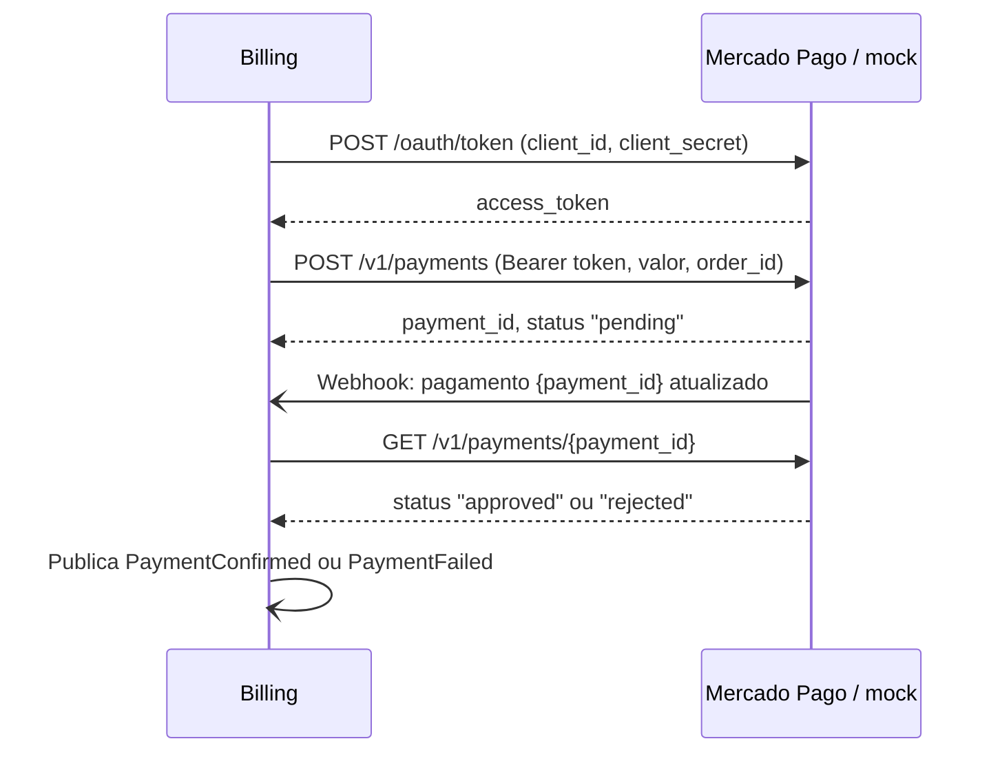

# ADR-007 — Integração de pagamento (Mercado Pago e mock)

| | |
|---|---|
| **Status** | Aceito |
| **Fase** | 4 |
| **Relacionado a** | [RFC-005 — Divisão em microsserviços](../rfc/RFC-005-microsservicos.md), [ADR-005 — Saga orquestrada](ADR-005-saga-orquestrada.md) |

## Contexto

O Billing Service precisa cobrar o cliente depois que o orçamento é
aprovado, integrando-se ao Mercado Pago. O acesso ao ambiente de testes
do Mercado Pago depende de credenciais que nem sempre estão disponíveis,
e o fluxo da Saga precisa ser demonstrável e testável de forma
previsível, inclusive nos cenários de pagamento recusado.

## Decisão

O Billing se comunica com o provedor de pagamento por **um único
adaptador HTTP, no formato da API do Mercado Pago**. O provedor real ou
um **mock** é escolhido apenas por configuração (URL base, `client_id` e
`client_secret`), sem mudança de código.

### Fluxo

- O token é obtido com `client_id` e `client_secret` e reutilizado até
  expirar.
- O webhook **apenas avisa** que houve mudança. O Billing consulta o
  status no provedor antes de confirmar, para não confiar no conteúdo
  recebido.
- Pagamento que não é confirmado dentro do prazo é tratado como
  **expirado**.
- O estorno, usado como compensação na Saga, é feito por
  `POST /v1/payments/{payment_id}/refunds`.

### Mock de pagamento

O repositório `payment-mock-autoshop` contém um serviço pequeno que
implementa essas mesmas rotas:

- emite e valida o token de acesso (sem token válido, retorna `401`);
- cria o pagamento como `pending` e, alguns segundos depois, chama o
  webhook do Billing;
- decide o resultado por uma regra fixa, para permitir demonstrar e
  testar os dois caminhos:

| Valor do pagamento | Resultado |
|---|---|
| Termina em `,13` (ex.: R$ 350,13) | `rejected` |
| Qualquer outro | `approved` |

- aceita estornos de pagamentos aprovados.

## Alternativas consideradas

| Opção | Motivo do descarte |
|---|---|
| **Apenas a integração real** | Depende de credenciais externas e não permite forçar recusas de forma previsível nos testes |
| **Mock dentro do próprio Billing** | Não exercita a chamada HTTP, a autenticação por token nem o webhook; o código testado seria diferente do usado com o provedor real |

## Consequências

- O mesmo código do Billing funciona com o Mercado Pago e com o mock.
- Recusa de pagamento e estorno podem ser demonstrados e testados de
  forma determinística, incluindo as compensações da Saga.
- O mock é um serviço a mais para implantar no cluster, mas não guarda
  dados nem contém regra de negócio da oficina.
