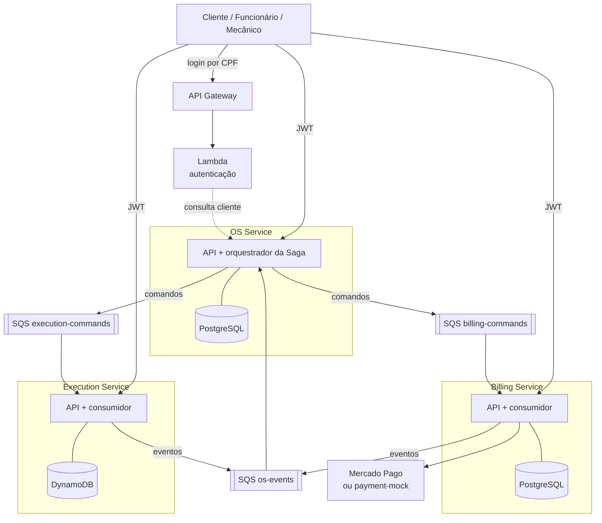
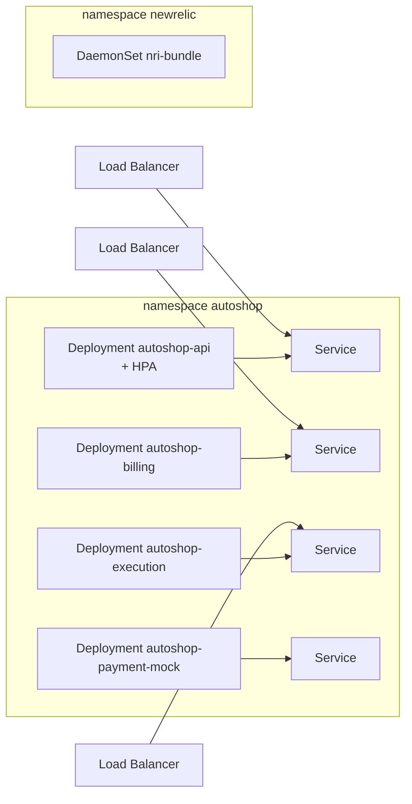
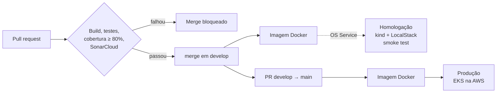

# Arquitetura

Visão geral da arquitetura da Fase 4: microsserviços, bancos, mensageria,
infraestrutura na AWS e fluxo de deploy. O fluxo da OS entre os serviços
está em [`saga-flow.md`](./saga-flow.md), e as decisões em
[`rfc/`](./rfc) e [`adr/`](./adr).

## Repositórios

| Repositório | Tipo | Conteúdo |
|---|---|---|
| `app-autoshop` | Microsserviço | OS Service (orquestrador da Saga) + documentação geral |
| `billing-autoshop` | Microsserviço | Billing Service |
| `execution-autoshop` | Microsserviço | Execution Service |
| `payment-mock-autoshop` | Apoio | Mock da API do Mercado Pago |
| `lambda-auth-autoshop` | Apoio | Login do cliente por CPF (Lambda + API Gateway) |
| `infra-k8s-autoshop` | Infraestrutura | Cluster EKS, filas SQS, IAM |
| `infra-db-autoshop` | Infraestrutura | Bancos (um Terraform independente por banco) |

## Visão geral



| Componente | Função |
|---|---|
| **API Gateway + Lambda** | `POST /auth`: valida o CPF, consulta o cliente no OS Service e emite o JWT |
| **Load Balancers** | Um por serviço (OS, Execution, Billing). Cada serviço valida o JWT no próprio middleware, com o mesmo segredo; o mock de pagamento só é acessível dentro do cluster |
| **OS, Billing, Execution** | Microsserviços em Go, cada um com o próprio banco e a própria fila de entrada |
| **SQS** | Comandos e eventos da Saga, com retentativa e DLQ ([ADR-006](adr/ADR-006-mensageria-sqs.md)) |
| **RDS / DynamoDB** | Um banco por serviço, sem acesso cruzado ([ADR-008](adr/ADR-008-banco-por-servico.md)) |
| **Serviços rodam no EKS** | Os três serviços e o mock rodam no mesmo cluster Kubernetes, cada um com o próprio Deployment |
| **Credenciais** | Usuário e senha de cada banco gerados pelo Terraform (guardados no Secrets Manager); o pipeline de cada serviço entrega a credencial ao pod por um Secret do Kubernetes |
| **New Relic** | APM dos três serviços, logs com `correlation_id`, eventos da Saga, dashboards e alertas versionados em Terraform |

## Estrutura interna de cada serviço

Os três microsserviços seguem as mesmas camadas usadas desde a Fase 1:

```
cmd/api/        ponto de entrada: API HTTP, consumidor SQS e rotinas em segundo plano
internal/
  handler/      rotas HTTP
  middleware/   validação do JWT e logs
  consumer/     leitura das mensagens SQS
  messaging/    formato das mensagens da Saga e envio ao SQS
  usecase/      regras de negócio (no OS Service, também o orquestrador)
  domain/       entidades e validações
  repository/   acesso ao banco do próprio serviço
pkg/            autenticação, configuração, erros, observabilidade
```

## Kubernetes



- Cada um dos três serviços tem Deployment, Service, ConfigMap, Secret e
  ServiceAccount próprios, versionados no próprio repositório. O OS
  Service tem também um HPA. O mock tem Deployment, Service e ConfigMap.
- Os ServiceAccounts usam IRSA: cada pod recebe permissão apenas nas
  próprias filas e, no caso do Execution, nas tabelas do DynamoDB.
- App, Execution e Billing são expostos por Load Balancers (Service do
  tipo `LoadBalancer`); o mock de pagamento usa `ClusterIP`.

## Fluxo de deploy

Cada repositório tem pipeline próprio no GitHub Actions. As branches
`main` e `develop` são protegidas: só recebem alterações por pull
request, e o merge exige que as checagens passem.



| Ambiente | Onde roda | Disparo |
|---|---|---|
| Homologação (OS Service) | Cluster kind efêmero no pipeline do `infra-k8s-autoshop`, com PostgreSQL e LocalStack (filas da Saga) | Merge em `develop` do `app-autoshop` |
| Produção | EKS, RDS, DynamoDB e SQS na AWS | Merge em `main` |

## Tecnologias

| Tecnologia | Uso | Motivo |
|---|---|---|
| Go + Gin | Microsserviços e Lambda | Linguagem do projeto desde a Fase 1; binário pequeno e rápido |
| PostgreSQL (RDS) | OS e Billing | Dados relacionais e transações ([ADR-008](adr/ADR-008-banco-por-servico.md)) |
| DynamoDB | Execution | Acesso por chave, reserva atômica de estoque, sem servidor ([ADR-008](adr/ADR-008-banco-por-servico.md)) |
| Amazon SQS | Mensageria da Saga | Gerenciado, com DLQ, sem broker para operar ([ADR-006](adr/ADR-006-mensageria-sqs.md)) |
| Saga orquestrada | Consistência entre serviços | Fluxo e compensações em um só lugar ([ADR-005](adr/ADR-005-saga-orquestrada.md)) |
| Kubernetes (EKS) | Execução dos serviços | Deploy declarativo por serviço, HPA no OS Service e permissões por pod (IRSA) |
| API Gateway + Lambda | Login do cliente por CPF | Autenticação isolada, sem acesso ao banco do OS |
| Terraform | Toda a infraestrutura | Infraestrutura versionada e reproduzível |
| GitHub Actions + SonarCloud | CI/CD e qualidade | Pipeline e análise por repositório |
| New Relic | Observabilidade | APM, logs, eventos de negócio e alertas ([RFC-004](rfc/RFC-004-observabilidade.md)) |
| LocalStack + kind | Desenvolvimento e homologação | Mesmas APIs da AWS, sem custo |
