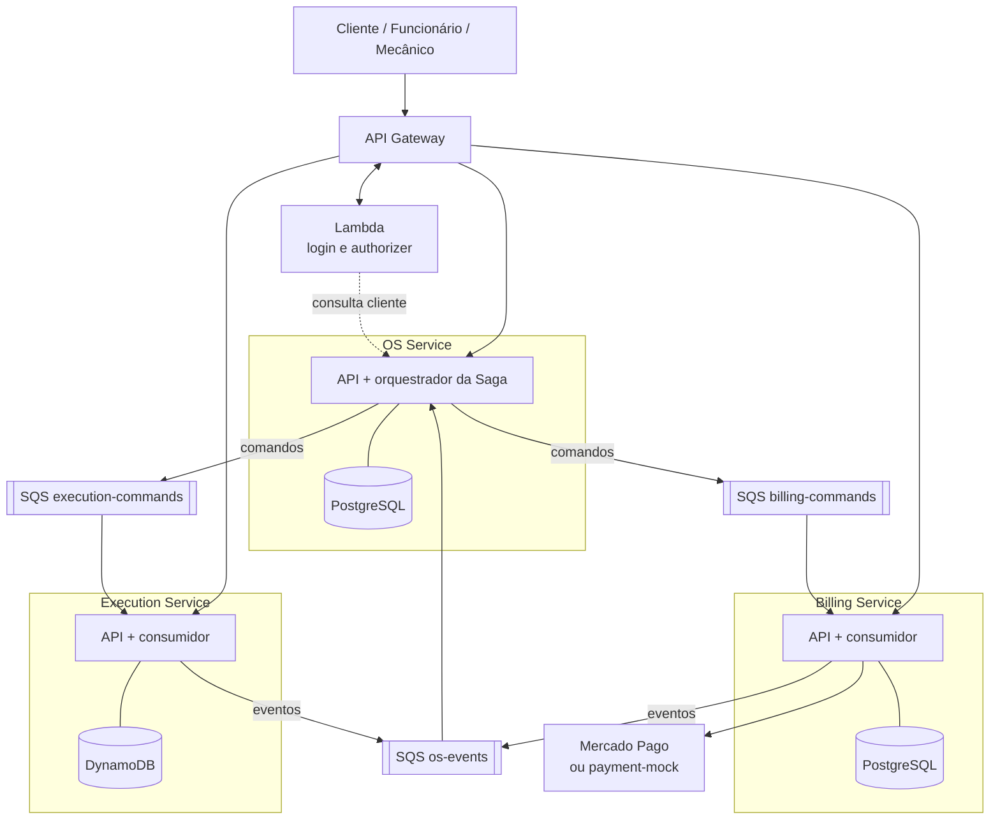
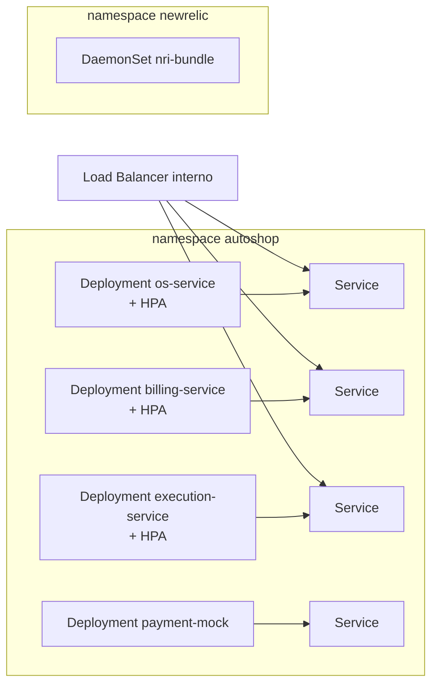
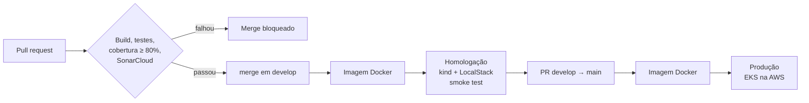

# Arquitetura

Visão geral da arquitetura da Fase 4: microsserviços, bancos, mensageria,
infraestrutura na AWS e fluxo de deploy. O fluxo da OS entre os serviços
está em [`saga-flow.md`](./saga-flow.md), e as decisões em
[`rfc/`](./rfc) e [`adr/`](./adr).

## Repositórios

| Repositório | Tipo | Conteúdo |
|---|---|---|
| `app-autoshop` | Microsserviço | OS Service (orquestrador da Saga) + documentação geral |
| `billing-autoshop` | Microsserviço | Billing Service |
| `execution-autoshop` | Microsserviço | Execution Service |
| `payment-mock-autoshop` | Apoio | Mock da API do Mercado Pago |
| `lambda-auth-autoshop` | Apoio | Login por CPF e authorizer do API Gateway |
| `infra-k8s-autoshop` | Infraestrutura | Cluster EKS, API Gateway, rede, IAM |
| `infra-db-autoshop` | Infraestrutura | Bancos (um Terraform independente por banco) |

## Visão geral



| Componente | Função |
|---|---|
| **API Gateway** | Única porta de entrada. Roteia cada caminho para o serviço dono e exige token válido em todas as rotas, exceto login, consulta de status e aprovação da OS pelo cliente |
| **Lambda** | `/auth`: valida o CPF, consulta o cliente no OS Service e emite o JWT. Authorizer: valida assinatura e validade do JWT em cada requisição |
| **OS, Billing, Execution** | Microsserviços em Go, cada um com o próprio banco e a própria fila de entrada |
| **SQS** | Comandos e eventos da Saga, com retentativa e DLQ ([ADR-006](adr/ADR-006-mensageria-sqs.md)) |
| **RDS / DynamoDB** | Um banco por serviço, sem acesso cruzado ([ADR-008](adr/ADR-008-banco-por-servico.md)) |
| **Serviços rodam no EKS** | Os três serviços e o mock rodam no mesmo cluster Kubernetes, cada um com o próprio Deployment |
| **Secrets Manager** | Credenciais de banco e chaves, entregues apenas ao pod de cada serviço |
| **New Relic** | APM e trace distribuído entre os serviços, logs com `correlation_id`, dashboards e alertas versionados em Terraform |

## Estrutura interna de cada serviço

Os três microsserviços seguem as mesmas camadas usadas desde a Fase 1:

```
cmd/            ponto de entrada (API HTTP e consumidor SQS)
internal/
  handler/      rotas HTTP
  consumer/     leitura das mensagens SQS
  usecase/      regras de negócio
  domain/       entidades e validações
  repository/   acesso ao banco do próprio serviço
  publisher/    envio de mensagens SQS
pkg/            observabilidade, configuração, erros
```

## Kubernetes



- Cada serviço tem Deployment, Service, HPA, ConfigMap e ServiceAccount
  próprios, versionados no próprio repositório.
- Os ServiceAccounts usam IRSA: cada pod recebe permissão apenas nas
  próprias filas, no próprio segredo e, no caso do Execution, nas
  próprias tabelas do DynamoDB.
- O API Gateway chega aos serviços por um VPC Link até um Load Balancer
  interno; os serviços não ficam expostos diretamente à internet.

## Fluxo de deploy

Cada repositório tem pipeline próprio no GitHub Actions. As branches
`main` e `develop` são protegidas: só recebem alterações por pull
request, e o merge exige que as checagens passem.



| Ambiente | Onde roda | Disparo |
|---|---|---|
| Homologação | Cluster kind efêmero no próprio pipeline, com LocalStack (SQS e DynamoDB) e PostgreSQL em container | Merge em `develop` |
| Produção | EKS, RDS, DynamoDB e SQS na AWS | Merge em `main` |

## Tecnologias

| Tecnologia | Uso | Motivo |
|---|---|---|
| Go + Gin | Microsserviços e Lambda | Linguagem do projeto desde a Fase 1; binário pequeno e rápido |
| PostgreSQL (RDS) | OS e Billing | Dados relacionais e transações ([ADR-008](adr/ADR-008-banco-por-servico.md)) |
| DynamoDB | Execution | Acesso por chave, reserva atômica de estoque, sem servidor ([ADR-008](adr/ADR-008-banco-por-servico.md)) |
| Amazon SQS | Mensageria da Saga | Gerenciado, com DLQ, sem broker para operar ([ADR-006](adr/ADR-006-mensageria-sqs.md)) |
| Saga orquestrada | Consistência entre serviços | Fluxo e compensações em um só lugar ([ADR-005](adr/ADR-005-saga-orquestrada.md)) |
| Kubernetes (EKS) | Execução dos serviços | Escala por serviço com HPA |
| API Gateway + Lambda | Entrada e autenticação | Controle de acesso centralizado |
| Terraform | Toda a infraestrutura | Infraestrutura versionada e reproduzível |
| GitHub Actions + SonarCloud | CI/CD e qualidade | Pipeline e análise por repositório |
| New Relic | Observabilidade | APM, trace distribuído, logs e alertas ([RFC-004](rfc/RFC-004-observabilidade.md)) |
| LocalStack + kind | Desenvolvimento e homologação | Mesmas APIs da AWS, sem custo |
