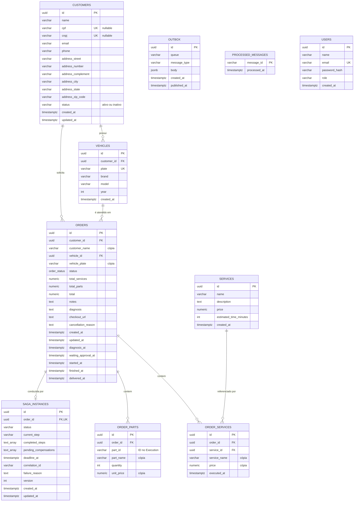

# Modelo Entidade-Relacionamento — OS Service (PostgreSQL)

Schema do banco do OS Service, resultado das migrations em
[`migrations/`](../../migrations). Na Fase 4, as peças e o estoque passaram
para o Execution Service (DynamoDB): a OS guarda só uma cópia de nome,
preço e quantidade das peças usadas. As tabelas `saga_instances`, `outbox`
e `processed_messages` guardam o estado da Saga
([ADR-005](../adr/ADR-005-saga-orquestrada.md)).

## Decisões de modelagem

- **Cliente, veículo e OS (1:N):** um cliente tem vários veículos e várias
  OS; cada OS tem um veículo. As chaves estrangeiras de `orders` usam
  `ON DELETE RESTRICT`: não é possível apagar cliente ou veículo com OS.
- **Endereço em colunas de `customers`:** o endereço é 1:1 com o cliente e
  não é compartilhado, então fica na própria tabela (`address_*`).
- **CPF ou CNPJ:** `CHECK (cpf IS NOT NULL OR cnpj IS NOT NULL)` e índices
  únicos parciais em cada documento.
- **Cópias na OS:** nome do cliente, placa, nome e preço de serviços e
  peças são gravados no momento da abertura. Uma mudança de preço ou de
  cadastro não altera OS antigas.
- **Peças sem chave estrangeira:** o catálogo de peças pertence ao
  Execution Service. `order_parts.part_id` guarda o ID da peça lá, sem
  referência a uma tabela local.
- **`order_status` como ENUM:** `recebida`, `em_diagnostico`,
  `aguardando_aprovacao`, `aguardando_pagamento`, `aguardando_execucao`,
  `em_execucao`, `finalizada`, `entregue`, `recusada`, `cancelada`. Um
  status inválido não é gravado.
- **Datas por status:** `diagnosis_at`, `waiting_approval_at`,
  `started_at`, `finished_at` e `delivered_at` são gravadas quando a OS
  entra em cada status e alimentam as métricas de tempo médio.
- **Saga na mesma base da OS:** a OS, a Saga e os comandos da `outbox` são
  gravados na mesma transação. `version` impede que duas decisões
  simultâneas sobre a mesma OS se sobreponham; `deadline_at` é o prazo do
  passo atual.
- **`processed_messages`:** IDs dos eventos já aplicados, para ignorar
  entregas repetidas do SQS.
