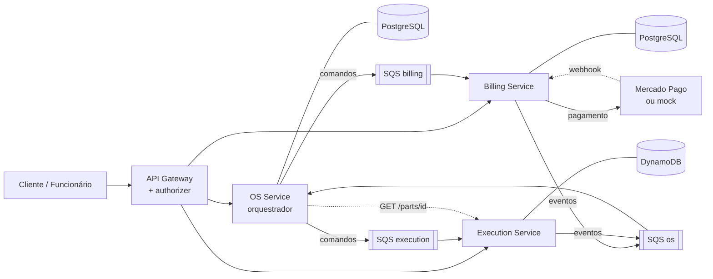

# RFC-005 — Divisão em microsserviços

| | |
|---|---|
| **Status** | Aceito |
| **Fase** | 4 |
| **Autores** | Jackeline Carvalho |
| **Relacionado a** | ADR-005 (Saga orquestrada), ADR-006 (Mensageria com SQS), ADR-007 (Pagamento), ADR-008 (Banco por serviço) |

## Contexto

A oficina passou a operar com várias filiais, e as áreas de atendimento,
execução e cobrança passaram a ter volumes e ritmos diferentes. A
aplicação, até então uma única API com um único banco, é dividida em
microsserviços independentes, cada um com repositório, infraestrutura e
banco próprios.

## Decisão

### Serviços

| Serviço | Repositório | Responsabilidade | Banco |
|---|---|---|---|
| **OS Service** | `app-autoshop` | Clientes, veículos, catálogo de serviços, abertura e consulta de OS, histórico de status, aprovação do orçamento. **Orquestra a Saga** | PostgreSQL |
| **Billing Service** | `billing-autoshop` | Orçamento, cobrança, confirmação e estorno de pagamento | PostgreSQL |
| **Execution Service** | `execution-autoshop` | Diagnóstico, peças e estoque, reserva de peças, fila de execução, início e finalização dos reparos | DynamoDB |

Componentes de apoio (não são microsserviços de negócio):

| Componente | Repositório | Papel |
|---|---|---|
| Autenticação | `lambda-auth-autoshop` | Login por CPF e validação do token no API Gateway |
| Mock de pagamento | `payment-mock-autoshop` | Simula a API do Mercado Pago (ver ADR-007) |
| Cluster | `infra-k8s-autoshop` | Kubernetes, API Gateway, rede |
| Bancos | `infra-db-autoshop` | Um Terraform independente por banco |

### Dono de cada dado

Cada dado tem um único dono, o único serviço que pode alterá-lo. Os
demais recebem uma cópia dentro das mensagens.

| Dado | Dono | Como os outros recebem |
|---|---|---|
| Clientes | OS | Autenticação consulta por REST interno |
| Veículos, catálogo de serviços, OS e histórico | OS | Billing e Execution recebem o necessário nos comandos da Saga |
| Peças e estoque | Execution | OS consulta nome e preço por REST ao abrir a OS |
| Reservas, fila de execução, diagnóstico | Execution | OS recebe os eventos |
| Orçamentos e pagamentos | Billing | OS recebe os eventos |

### Comunicação

| Tipo | Uso |
|---|---|
| **Assíncrona (SQS)** | Todo o fluxo da OS entre serviços: comandos do orquestrador e respostas dos serviços (ADR-006) |
| **REST síncrono** | Usuário → API Gateway → serviços. Entre serviços, só duas leituras: OS → Execution `GET /parts/{id}` ao abrir a OS, e Autenticação → OS `GET /internal/customers/by-cpf/{cpf}` no login |
| **Webhook** | Mercado Pago (ou mock) → Billing, confirmando o pagamento |

Todas as mensagens carregam um `correlation_id`, que permite seguir uma
mesma OS por todos os serviços no New Relic.

### Autenticação

A autenticação não acessa o banco do OS Service. Ela consulta o cliente
pela rota interna `GET /internal/customers/by-cpf/{cpf}`, que não é
exposta no API Gateway. Se o OS Service não responder, o login retorna
`503`. O authorizer do API Gateway apenas valida a assinatura e a
validade do token, sem depender de nenhum serviço.

## Alternativas consideradas

- **Serviço exclusivo para a Saga:** descartado. O orquestrador
  precisaria consultar a OS em outro serviço a cada passo. No OS
  Service, estado da Saga e da OS ficam na mesma transação.
- **Estoque no OS Service:** descartado. A reserva de peças é a
  principal operação a ser compensada na Saga, e separar peças para o
  reparo é responsabilidade da execução.

## Consequências

- Cada serviço é implantado, escalado e testado de forma independente;
  falha no Billing não impede abrir ou consultar OS.
- A consistência entre serviços passa a ser eventual, garantida pela
  Saga com compensações (ADR-005), retentativas e idempotência
  (ADR-006).
- As regras de negócio das fases anteriores são mantidas; muda apenas
  qual serviço executa cada uma.
