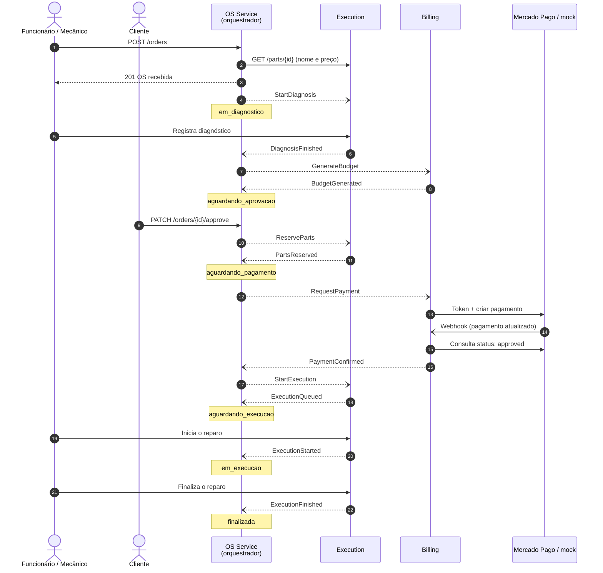
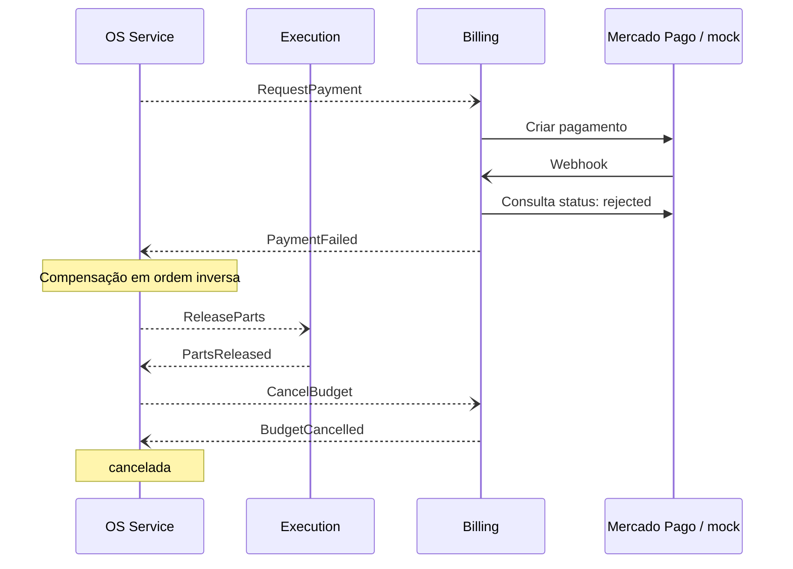
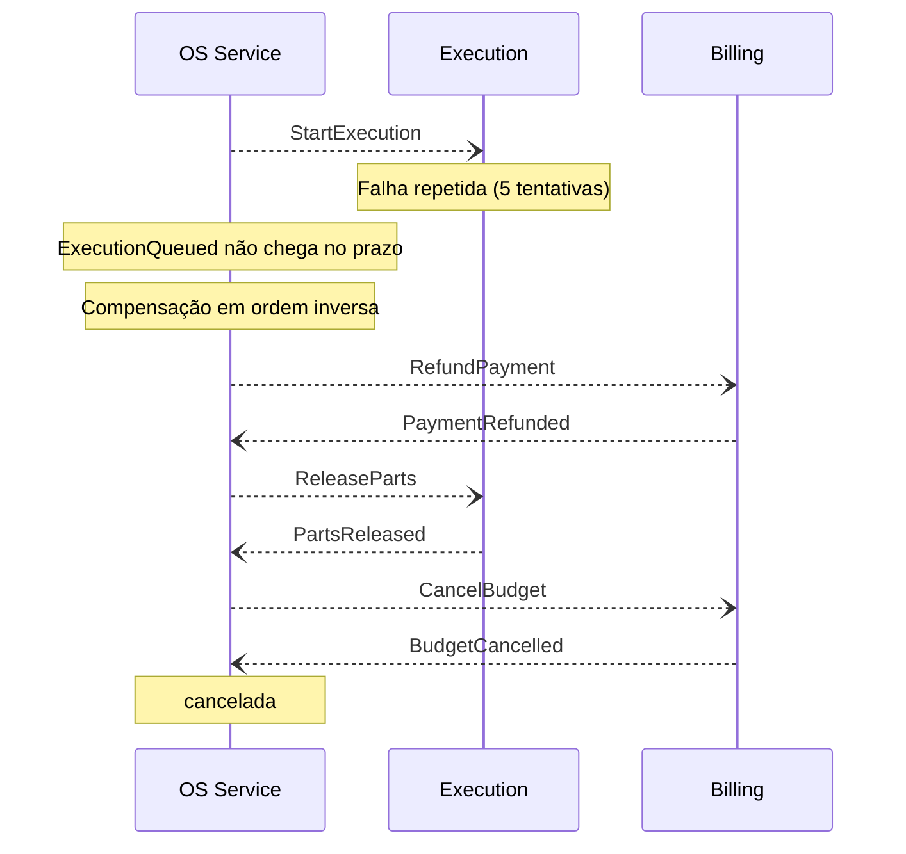
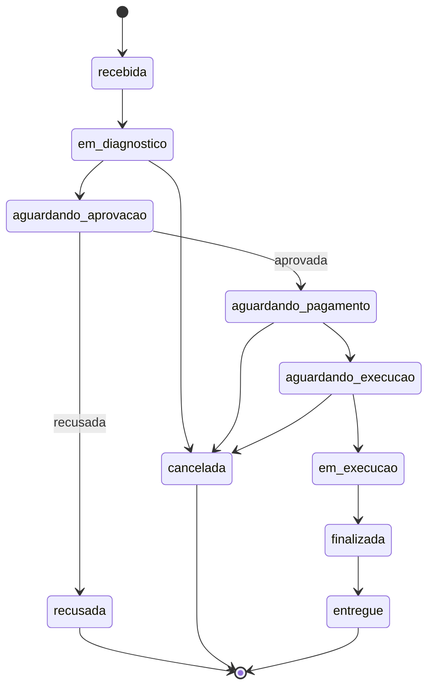

# Fluxo da Ordem de Serviço (Saga)

Este documento mostra o caminho completo de uma OS, da abertura ao
pagamento e à finalização, indicando qual serviço é responsável por cada
etapa e como os serviços se comunicam. As decisões estão em
[ADR-005](adr/ADR-005-saga-orquestrada.md) (Saga orquestrada) e
[ADR-006](adr/ADR-006-mensageria-sqs.md) (SQS).

## Responsáveis por etapa

| Etapa | Responsável | Ação de quem usa o sistema |
|---|---|---|
| Abertura da OS | OS Service | Funcionário abre a OS |
| Diagnóstico | Execution | Mecânico registra o diagnóstico |
| Orçamento | Billing | — (gerado automaticamente) |
| Aprovação | OS Service | Cliente aprova ou recusa |
| Reserva de peças | Execution | — |
| Pagamento | Billing + Mercado Pago (ou mock) | Cliente paga |
| Execução | Execution | Mecânico inicia e finaliza o reparo |
| Entrega | OS Service | Funcionário registra a entrega |

## Caminho feliz

Setas contínuas são chamadas HTTP; setas tracejadas são mensagens SQS.

## Compensação: pagamento recusado

As peças já estavam reservadas. Como o pagamento não aconteceu, a reserva
é desfeita e o orçamento cancelado.

## Compensação: execução não inicia após o pagamento

É o cenário com mais passos a desfazer: pagamento, reserva e orçamento.

## Todos os cenários de falha

| Falha | O que já foi feito em outro serviço | Compensação | Status final |
|---|---|---|---|
| Diagnóstico não conclui | Nada | Nenhuma | `cancelada` |
| Orçamento não é gerado | Diagnóstico (apenas registro) | Nenhuma | `cancelada` |
| Cliente recusa o orçamento | Orçamento | Cancelar orçamento | `recusada` |
| Estoque insuficiente | Orçamento | Cancelar orçamento | `cancelada` |
| Pagamento recusado ou expirado | Orçamento, reserva | Liberar peças, cancelar orçamento | `cancelada` |
| Execução não inicia | Orçamento, reserva, pagamento | Estornar, liberar peças, cancelar orçamento | `cancelada` |

Em todos os casos, falhas técnicas são retentadas antes (até 5 vezes) e
cada falha gera um evento no New Relic.

## Status da OS

